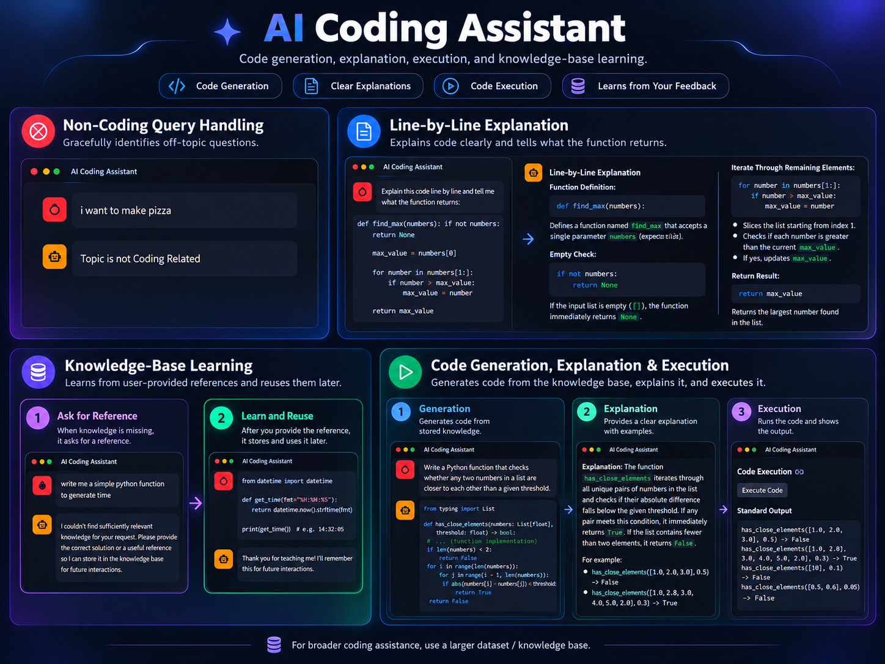

# AI Coding Assistant

An AI-powered coding assistant that can generate code, explain code line by line, execute generated Python code, reject unrelated requests, and learn new coding knowledge through a persistent ChromaDB knowledge base.

<p align="center">
  
</p>

## Overview

This project combines an LLM with retrieval-augmented generation (RAG) to provide coding assistance from a persistent knowledge base.

The assistant can:

- generate Python code from stored coding knowledge
- explain submitted or generated code in detail
- execute Python code and display its standard output
- identify prompts that are not coding related
- retrieve relevant information from ChromaDB
- ask for a useful reference when relevant knowledge is missing
- store newly provided coding knowledge for later retrieval

The goal is to build a coding assistant that does more than generate responses: it can reuse stored knowledge and expand its knowledge base through user-provided examples.

## Features

### Code Generation

The assistant retrieves relevant coding knowledge from the vector database and uses it to generate a complete response.

Generated answers can include:

- Python functions
- comments and documentation
- example usage
- test cases
- explanations of the generated logic

### Line-by-Line Code Explanation

Users can submit code and ask the assistant to explain how it works.

The assistant can describe:

- function definitions
- variables
- loops and conditions
- return values
- edge cases
- example inputs and outputs

### Code Execution

Generated Python code can be executed directly from the interface, allowing the user to inspect the program output without leaving the application.

> **Security note:** executing generated code locally can be unsafe. Only execute code you trust. A sandboxed execution environment should be used before exposing this feature publicly.

### Non-Coding Query Handling

The assistant checks whether a request is related to programming before processing it.

For unrelated requests, it responds without attempting to generate irrelevant coding output.

### Knowledge-Base Learning

When the assistant cannot find sufficiently relevant information in its current knowledge base, it can request a correct solution or useful reference from the user.

That information can then be stored in ChromaDB and retrieved during future interactions.

This creates a simple learning workflow:

```text
User request
     |
     v
Search ChromaDB
     |
     +---- Relevant knowledge found ----> Generate response
     |
     +---- Knowledge not found
                |
                v
        Ask user for reference
                |
                v
        Store new knowledge
                |
                v
        Retrieve it in future queries
```

## How It Works

```text
                    User Prompt
                        |
                        v
              Coding Relevance Check
                        |
             +----------+----------+
             |                     |
        Not Coding             Coding Related
             |                     |
             v                     v
      Reject / Inform        Query Embedding
                                   |
                                   v
                              ChromaDB Search
                                   |
                       +-----------+-----------+
                       |                       |
                 Relevant Data            No Relevant Data
                       |                       |
                       v                       v
                  LLM Response          Request Reference
                       |                       |
                       |                 Store New Knowledge
                       |
              +--------+--------+
              |                 |
         Explanation       Code Execution
```

## Technology Stack

- **Python**
- **Streamlit** for the user interface
- **LangChain** for LLM and retrieval workflow orchestration
- **ChromaDB** for persistent vector storage
- **Embeddings** for semantic similarity search
- **LLM API** for code generation and explanation

## Project Structure

A clean repository structure can look like this:

```text
AI-Coding-Assistant/
│
├── app.py
├── backend.py
├── README.md
├── requirements.txt
├── .gitignore
├── .env.example
│
├── assets/
│   └── ai_coding_assistant_feature_showcase.png
│
└── Chroma_database/        # generated locally; usually excluded from Git
```

The following files and folders should normally remain local and should not be committed:

```text
.env
__pycache__/
*.pyc
Chroma_database/
```

Example `.gitignore`:

```gitignore
.env
__pycache__/
*.pyc
Chroma_database/
```

## Installation

Clone the repository:

```bash
git clone https://github.com/Kazzzyz/ai-coding-assistant.git
cd AI-Coding-Assistant
```

Create and activate a virtual environment.

### Windows

```bash
python -m venv .venv
.venv\Scripts\activate
```

### macOS / Linux

```bash
python3 -m venv .venv
source .venv/bin/activate
```

Install the dependencies:

```bash
pip install -r requirements.txt
```

## Environment Variables

Keep API keys and other secrets inside a local `.env` file.

Do **not** upload `.env` to GitHub.

A public `.env.example` can be included to show which variables are required without exposing real credentials.

Example:

```env
API_KEY=your_api_key_here
```

Update the variable name above to match the key expected by `backend.py`.

## Running the Application

Start the Streamlit application with:

```bash
streamlit run app.py
```

Then open the local address displayed by Streamlit in your browser.

## Expanding the Knowledge Base

The quality and coverage of retrieval depend heavily on the information stored in the vector database.

For broader coding assistance, add a **larger and more diverse coding dataset / knowledge base**. A larger collection of high-quality examples, documentation, algorithms, debugging cases, and programming concepts will allow the assistant to retrieve useful context for a wider range of coding requests.

Possible additions include:

- Python programming examples
- algorithms and data structures
- common debugging problems
- library and framework documentation
- database examples
- machine-learning code
- API usage examples
- software design patterns
- testing examples

Dataset quality matters as much as dataset size. Relevant, well-structured examples generally produce better retrieval than simply adding large amounts of unrelated text.

## Current Limitations

- Coding coverage is limited by the size and quality of the current knowledge base.
- Retrieval quality depends on the embedding model and similarity threshold.
- Generated code may still contain errors and should be reviewed before use.
- Local code execution is not a secure sandbox.
- The assistant is intended as a coding aid rather than a replacement for testing, documentation, or code review.

## Future Improvements

Potential improvements include:

- expanding the coding knowledge base
- adding support for additional programming languages
- improving retrieval and reranking
- adding source references for retrieved knowledge
- sandboxing code execution
- adding automated tests for generated code
- improving conversation memory
- adding evaluation metrics for retrieval and generation quality

## Disclaimer

This project is intended for educational and experimental use. Generated code should be reviewed and tested before being used in production.
